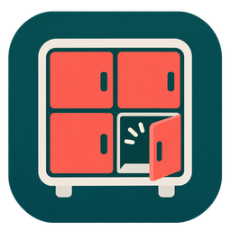

# DHL Packstation Availability für Home Assistant



Diese inoffizielle HACS-Integration zeigt freie Fächer einer DHL-Packstation nach Größe: S, M, L, XL und gesamt. Sie liest den DHL-Postfinder-Endpunkt ohne Anmeldung oder API-Schlüssel. Jede Station wird alle 15 Minuten abgefragt.

[In HACS oder Marketplace öffnen](https://my.home-assistant.io/redirect/hacs_repository/?owner=TylonHH&repository=dhl-packstation-availability&category=integration). Bis zur Aufnahme in den Suchkatalog lässt sich das Repository über diesen Link als benutzerdefinierte Integration hinzufügen.

In HACS zeigt die Repository-Seite diese Beschreibung und die folgenden Installationsschritte. In Home Assistant erklärt der Einrichtungsdialog Funktion, Intervall und benötigte Angaben. Das eigenständige Symbol erscheint in Home Assistant ab Version 2026.3. Die neue Marketplace-Oberfläche ab Home Assistant 2026.11 unterstützt ebenfalls lokale Integrationssymbole. Ältere HACS-Katalogansichten können weiterhin ein Platzhaltersymbol zeigen.

## Voraussetzungen

- Home Assistant 2024.6 oder neuer
- Zugriff von Home Assistant auf `www.dhl.de`
- Eine Packstation, für die DHL im Postfinder `liveStatus` mit Fachzahlen liefert
- Für Installation über HACS: [HACS](https://www.hacs.xyz/docs/use/)

## Postleitzahl und Packstation-Nummer finden

Öffne den [DHL Standortfinder](https://www.dhl.de/de/privatkunden/dhl-standorte-finden.html) und wähle deine Packstation. Benötigt werden nur ihre fünfstellige Postleitzahl und ihre dreistellige Packstation-Nummer. Die persönliche DHL-Postnummer ist **nicht** gemeint.

Die Integration bildet daraus selbst den DHL-Endpunkt. Beispiel: Postleitzahl `23611` und Packstation `202` ergeben die Kennung `1-23611202`. Bei einer führenden Null wird nur die interne Kennung gekürzt: `01067` und Packstation `103` ergeben `1-1067103`. Im Einrichtungsdialog und bei der Prüfung der DHL-Antwort bleibt die Postleitzahl `01067` erhalten.

## Installation

### HACS

1. In HACS **Drei Punkte → Benutzerdefinierte Repositories** öffnen.
2. Repository-URL `https://github.com/TylonHH/dhl-packstation-availability` eintragen und Typ **Integration** wählen.
3. **DHL Packstation Availability** installieren.
4. Home Assistant neu starten.

### Manuell

Ordner `custom_components/dhl_packstation_availability` nach `<config>/custom_components/` kopieren. Home Assistant neu starten.

## Einrichten

In **Einstellungen → Geräte & Dienste → Integration hinzufügen** nach **DHL Packstation Availability** suchen. Postleitzahl und Packstation-Nummer eingeben. Für jede weitere Station die Integration erneut hinzufügen. Jede Station hat einen eigenen Endpunkt und fünf eigene Sensoren; dieselbe Station kann nur einmal eingerichtet werden. Bereits mit einer Postfinder-ID eingerichtete Stationen funktionieren nach dem Update weiter.

## Auslesen

Pro Station entstehen fünf Sensoren: **Freie Fächer S**, **M**, **L**, **XL** und **gesamt**. Entitäts-IDs legt Home Assistant anhand des Stationsnamens fest. Die genaue ID steht unter **Einstellungen → Geräte & Dienste → Entitäten**. Sensorattribute `source_timestamp` und `address` zeigen Zeitpunkt der DHL-Quelldaten und Standortadresse. `0` bedeutet kein freies Fach. Fehlt eine Größe in der DHL-Antwort, ist ihr Sensor `unavailable`; Gesamt ist dann ebenfalls `unavailable`.

Beispiel einer Template-Bedingung für mindestens ein XL-Fach (Entitäts-ID anpassen):

```yaml
condition: template
value_template: "{{ states('sensor.parkdeck_freie_facher_xl') | int(0) > 0 }}"
```

Für Benachrichtigungen kannst du in der Home-Assistant-Oberfläche einen **Numerischer Zustand**-Trigger auf den gewünschten Sensor setzen, Schwelle **über 0**.

## Grenzen

Der verwendete Postfinder-Endpunkt ist keine dokumentierte öffentliche API. DHL kann Felder oder Zugriff jederzeit ändern. Nicht jede Packstation liefert Live-Fachzahlen. Werte können gegenüber der tatsächlichen Belegung verzögert sein. Bei HTTP-Fehlern oder fehlenden Daten werden Sensoren nicht als `0` ausgegeben. Diese Integration stammt nicht von DHL und ermöglicht weder Paketverfolgung noch Fachreservierung oder Öffnen einer Packstation.

Code: [MIT-Lizenz](LICENSE). DHL-Daten und Marken bleiben Eigentum ihrer jeweiligen Inhaber.

Das Symbol zeigt eine generische Fächeranlage ohne DHL- oder Home-Assistant-Logo. Es ist Teil dieses Repositories und kein offizielles Markenzeichen von DHL.

## Versionen und Beiträge

[Versionsverlauf](CHANGELOG.md) und [GitHub-Releases](https://github.com/TylonHH/dhl-packstation-availability/releases) erklären jede veröffentlichte Änderung. Für künftige Änderungen erstellt Release Please automatisch einen Release-Pull-Request mit neuer Version und Changelog. Nach Prüfung merged nur `@TylonHH` diesen Pull Request; dann erstellt die Automatisierung den Tag und das Release. Beiträge sind willkommen. Regeln für Pull Requests stehen in [CONTRIBUTING.md](CONTRIBUTING.md).
